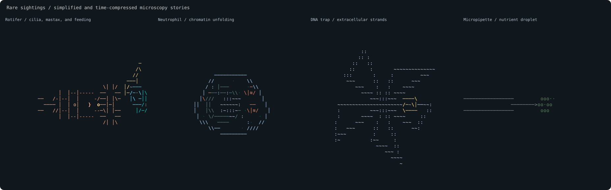

# Rare sightings

Rare events are quiet, extended vignettes rather than constant disruptions. A
seeded scheduler waits 3–6 minutes before an opportunity, runs at most one event,
and waits another 3–6 minutes after it ends. The same type has a 15-minute
cooldown. An opportunity can be skipped when the scene lacks room or a suitable
subject. Small windows may therefore have fewer sightings.

## Rotifer visitor

In mixed or microbial scenes at least 80×24, a coral-colored rotifer enters from
an edge. Its forked foot, segmented body, moving jaws, and two beating ciliary
crowns distinguish it from the single-celled inhabitants. It pauses to feed;
local currents draw nearby specks and bacteria toward its mouth. A meal moves
from the mouth into the gut and fragments before fading.

The visitor consumes at most three unclaimed, uninfected bacteria and preserves
a minimum population. Its body blocks free particles. It normally backs out
through the entry edge after retracting its crowns. If a changing population
blocks its route, it gradually fades out of focus rather than jumping away.
It does not establish a reproducing rotifer population.

Rotifer feeding currents are real; dimensions and feeding choices here are
simplified for illustration. See the [feeding-current microscopy study](https://pmc.ncbi.nlm.nih.gov/articles/PMC4136613/).

## Neutrophil DNA trap

A resting or pursuing neutrophil near several microbes can begin releasing a
trap. A pursuit is released cleanly; an ongoing engulfment is never interrupted. Its
lobed nucleus becomes an expanding, pale-lilac chromatin web; the original cell
breaks down. Bacteria contacting the drawn strands become tethered and stop
swimming. At most three can be caught, and microbial population floors still
apply. Macrophage targeting takes precedence over trapping. The web eventually
fragments and fades, releasing any remaining swimmers. The existing replenishment
system can later replace the lost neutrophil through an edge arrival.

This represents a destructive form of neutrophil extracellular trap release,
not every route of NET formation. Real timing is heavily compressed. See the
[live-cell chromatin swelling study](https://www.nature.com/articles/s41467-018-06263-5).

## Micropipette

A neutral-gray glass tip enters from an edge, pauses, releases a muted-green
nutrient droplet into clear fluid, and withdraws. The droplet briefly stirs nearby
particles; ordinary nutrient-seeking behavior then brings bacteria toward it.
The glass is represented in a separate focal layer, so its shaft does not sweep
away the inhabitants. A blocked tip does not inject nutrients into a cell.

This is a staged laboratory intervention, not an autonomous biological behavior.
It is excluded by `--calm` and requires at least 80×24.

## Controls and timing

- `--no-events` disables all rare sightings.
- `--calm` excludes the micropipette but retains the biological sightings.
- `--observe` captions the active event. `s` shows its name and the cumulative
  rare-event count alongside the ordinary lifecycle statistics.
- Interactive pacing uses **unpaused wall time**, independent of `--speed`.
  Pausing, help, and undersized-terminal pauses also stop the event clock.
- Snapshots use simulated time for both the ecosystem and event clock so a seed,
  size, options, and `--at` reproduce the same frame within one program version.
  Unlike display-only settings, `--no-events` and calm's event restriction apply
  to snapshots too.

Regenerate the illustrated states with `python tools/sightings.py`. The drawings
use controlled simulation states and the actual renderer; they are not microscope
photographs. Event behavior and rendering live in `terminal_cells/events.py` and
`event_render.py` respectively.
